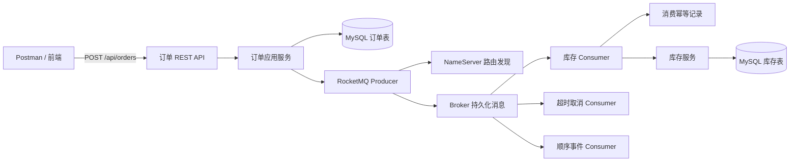
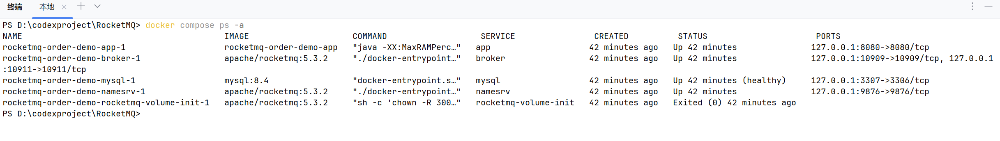
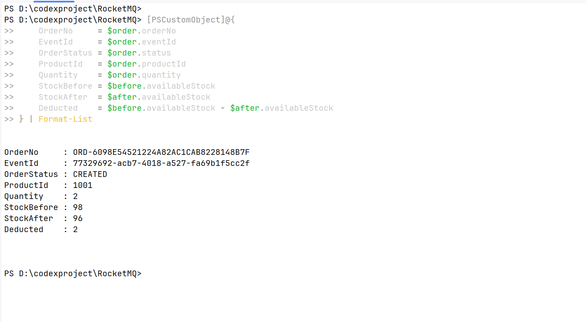
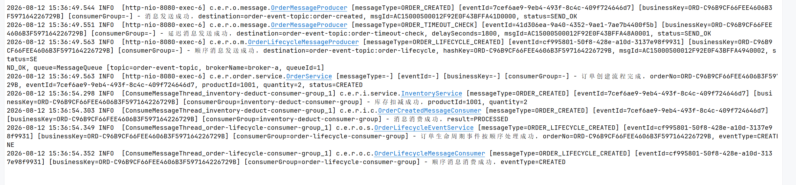

# RocketMQ 订单与库存可靠消息实战

一个基于 Java 17、Spring Boot、RocketMQ Spring Boot Starter 和 MySQL 的教学型电商项目。
项目不止演示“消息能发出去”，而是围绕订单创建、异步扣减库存、超时取消和订单状态流转，
实现消息发送确认、失败重试、事务消息、消费幂等、条件扣减与可检索日志等企业常见能力。

> 定位：可运行的分布式消息学习项目，也是用于展示工程能力的后端作品集。
> 当前采用模块化单体，订单与库存已按业务边界隔离，便于后续拆成独立服务。

## 核心能力

- 普通同步消息与异步消息，检查 Broker 返回的 `SendStatus`。
- 订单创建后异步扣减库存，使用条件 `UPDATE` 防止超卖。
- 30 分钟未支付延迟消息，消费者只取消仍为 `CREATED` 的订单。
- 同一订单使用 `orderNo` 选择固定 Message Queue，保证创建、支付、发货局部有序。
- RocketMQ 事务消息协调订单本地事务与“订单已创建”事件。
- 使用 `(consumer_group, event_id)` 唯一键实现消费幂等。
- Producer/Consumer 结构化上下文日志，支持按事件 ID 和业务主键排查。
- Flyway 管理数据库版本，REST API 提供参数校验与统一错误响应。
- Docker Compose 统一启动 MySQL、NameServer、Broker 和应用。
- GitHub Actions 在 Java 17 上自动执行无需外部中间件的测试集。

## 业务架构



一条订单创建消息的主要路径：Producer 先从 NameServer 查询 Topic 路由，再把消息发送到 Broker；
Broker 持久化后返回发送结果；属于库存 Consumer Group 的消费者拉取消息，在本地事务中记录幂等凭证并扣减库存，
成功后提交消费位点。订单接口无需同步等待库存逻辑，因此订单与库存得到解耦。

## 运行效果

### 1. 完整环境启动

MySQL、NameServer、Broker 和 Spring Boot 应用均正常运行；MySQL 通过健康检查，
RocketMQ 卷权限初始化服务完成任务后以状态码 0 正常退出。所有宿主机端口只绑定 `127.0.0.1`。



### 2. 订单驱动库存异步扣减

创建数量为 2 的订单后，接口立即返回 `CREATED`；RocketMQ Consumer 异步处理订单事件，
商品 `1001` 的库存由 98 扣减至 96，实际扣减量为 2。



### 3. 消息链路追踪

日志展示了普通消息、30 分钟延迟消息和顺序消息发送成功，以及库存扣减、幂等消费和生命周期事件处理结果。
`eventId`、`businessKey` 与 `consumerGroup` 可用于关联 Producer、Consumer 和具体业务订单。



## 可靠性设计

| 风险 | 当前方案 | 关键位置 |
|---|---|---|
| 发送超时或失败 | 同步/异步重试，校验发送状态，最终失败向业务抛出 | `infrastructure.messaging` |
| 订单已写库但普通消息未发送 | 提供事务消息接口，半消息提交取决于订单本地事务事实 | `order.transaction` |
| Broker 回查时客户端状态不明 | 按 `orderNo + eventId` 查询数据库并返回 COMMIT/ROLLBACK/UNKNOWN | `OrderCreateTransactionListener` |
| 消息重复投递 | 同一消费组与事件 ID 建立数据库唯一约束 | `message_consume_record` |
| 并发超卖 | `available_stock >= quantity` 条件更新，检查影响行数 | `InventoryRepository` |
| 订单状态并发覆盖 | 在同一条 SQL 中同时校验旧状态并更新新状态 | `OrderRepository` |
| 消费异常 | 业务异常继续抛出，由 RocketMQ 重试并最终进入死信队列 | Consumer 适配层 |
| 问题难追踪 | MDC 固定输出 messageType、eventId、businessKey、consumerGroup | `MessageLogContext` |

这里采用的是“至少一次投递 + 消费端幂等”，而不是宣称端到端恰好一次。生产系统还需要多副本 Broker、
监控告警、死信补偿平台、容量评估和故障演练。

## 技术栈

- Java 17
- Spring Boot 3.5
- RocketMQ Spring Boot Starter 2.3.5
- Apache RocketMQ 5.3.2
- MySQL 8.4、Spring JDBC、Flyway
- Maven、JUnit 5、Mockito
- Docker Compose、GitHub Actions

## 一键运行

前置条件：Docker Desktop 已启动，`docker compose version` 可以正常执行，并已安装 Java 17 与 Maven。

Compose 中的 `rocketmq-volume-init` 是一次性权限初始化服务：Docker 命名卷默认属于 root，
而官方 RocketMQ 镜像使用 uid/gid 3000 运行；该服务只把 Broker 存储和日志卷授权给 RocketMQ 用户，
完成后即退出，随后 Broker 才会启动。

```powershell
# 首次运行必须复制变量文件，并分别设置 root 密码和业务账号密码；.env 已被 Git 忽略
Copy-Item .env.example .env

# 在本机生成 Docker 镜像需要的可执行 JAR
mvn -DskipTests package

# 构建应用镜像并启动 MySQL、NameServer、Broker、Spring Boot
docker compose up --build -d

# 观察应用、Producer 和 Consumer 日志
docker compose logs -f app
```

看到 Spring Boot 启动成功后，先查询演示商品。Flyway 会初始化 `productId=1001`、库存 `100`：

```bash
curl http://localhost:8080/api/inventories/1001
```

创建普通消息订单：

```bash
curl -X POST http://localhost:8080/api/orders \
  -H "Content-Type: application/json" \
  -d '{"productId":1001,"quantity":2}'
```

稍等片刻再次查询库存，应从 `100` 变为 `98`，`version` 增加 1。响应中的 `orderNo` 可继续用于：

```bash
curl http://localhost:8080/api/orders/{orderNo}
curl -X POST http://localhost:8080/api/orders/{orderNo}/pay
curl -X POST http://localhost:8080/api/orders/{orderNo}/ship
```

对比事务消息创建流程：

```bash
curl -X POST http://localhost:8080/api/orders/transactional \
  -H "Content-Type: application/json" \
  -d '{"productId":1001,"quantity":1}'
```

停止环境：

```powershell
docker compose down
```

`docker compose down -v` 会同时删除 MySQL 与 RocketMQ 的本地卷，只应在明确需要重置演示数据时执行。

## REST API

| 方法 | 路径 | 作用 |
|---|---|---|
| POST | `/api/orders` | 普通消息创建订单，演示库存、延迟和顺序消息完整流程 |
| POST | `/api/orders/transactional` | 事务消息创建订单，演示本地事务与消息一致性 |
| GET | `/api/orders/{orderNo}` | 查询订单当前状态 |
| POST | `/api/orders/{orderNo}/pay` | CREATED → PAID，并发送顺序消息 |
| POST | `/api/orders/{orderNo}/ship` | PAID → SHIPPED，并发送顺序消息 |
| GET | `/api/inventories/{productId}` | 观察异步消费后的库存与版本号 |

参数错误返回 400，资源不存在返回 404，非法状态迁移返回 409；所有错误使用统一 JSON 结构。

## 在 IntelliJ IDEA 中运行

如果不使用完整 Compose，可沿用本地 Windows RocketMQ：

1. 使用 JDK 17 导入 Maven 工程并等待依赖加载完成。
2. 创建 MySQL 数据库：执行 `infrastructure/mysql/create-database.sql`。
3. 在 `RocketMqLearningApplication` 的“运行/调试配置 → 环境变量”中配置数据库账号。
   如果连接 Compose 中的 MySQL，应使用：
   `MYSQL_URL=jdbc:mysql://127.0.0.1:3307/rocketmq_learning?serverTimezone=UTC&useSSL=false&allowPublicKeyRetrieval=true;MYSQL_USERNAME=rocketmq_app;MYSQL_PASSWORD=你的业务账号密码;ROCKETMQ_NAME_SERVER=127.0.0.1:9876`。
4. 依次运行 `infrastructure/rocketmq/start-nameserver.cmd`、`start-broker.cmd`。
5. 运行 `RocketMqLearningApplication`，再用 IDEA HTTP Client、Postman 或浏览器调用 API。

密码只放在 IDEA 运行配置或本地 `.env`，不要写进 `application.yml`，也不要提交 `application-local.yml`。

## 测试

```powershell
# 无需 MySQL 和 RocketMQ，适合本地与 CI
mvn test
```

当前默认测试集共 60 项，包含业务单元测试、消息适配器测试、MVC 切片测试和架构约束测试。

测试分层约定：

- `*Test`：纯单元测试、MVC 切片测试或架构约束测试，默认执行。
- `*IT`：需要真实 MySQL/RocketMQ，按场景在 IDEA 中显式运行。
- `ArchitectureBoundaryTest`：防止领域层依赖 Spring/RocketMQ/JDBC，防止 Service 直接操作中间件。

## 项目结构

```text
src/main/java/com/example/rocketmq
├─ demo/basic                  普通同步、异步消息教学示例
├─ order
│  ├─ api                     HTTP 接口与统一异常响应
│  ├─ domain                  订单领域对象和状态
│  ├─ service/port            业务用例与消息发布端口
│  ├─ message                 Producer 和消息契约
│  ├─ consumer                延迟、顺序消息 Consumer
│  ├─ transaction             事务消息监听和本地事务
│  └─ repository              订单 JDBC 持久化
├─ inventory
│  ├─ api                     库存查询 API
│  ├─ domain/service          库存业务规则
│  ├─ consumer                订单创建消息 Consumer
│  └─ repository              条件扣减 SQL
└─ infrastructure/messaging   发送校验、幂等记录和消息日志上下文
```

更详细的依赖规则见 [ARCHITECTURE.md](ARCHITECTURE.md)。

## 配置项

| 环境变量 | 默认值 | 说明 |
|---|---|---|
| `MYSQL_URL` | `jdbc:mysql://127.0.0.1:3306/rocketmq_learning...` | JDBC 地址 |
| `MYSQL_USERNAME` | `root` | 本地手动运行的默认账号；Compose 会覆盖为 `rocketmq_app` |
| `MYSQL_PASSWORD` | 空 | 必须由本地环境提供 |
| `ROCKETMQ_NAME_SERVER` | `127.0.0.1:9876` | NameServer 地址 |
| `ROCKETMQ_PRODUCER_GROUP` | `rocketmq-learning-producer-group` | Producer Group |
| `DEMO_ROCKETMQ_ORDER_TIMEOUT_DELAY_SECONDS` | `1800` | 订单超时检查延迟秒数 |

Topic、Tag 与各 Consumer Group 也都可通过 `application.yml` 中对应的环境变量覆盖。

## 设计边界与后续方向

- Compose 是单 Broker 开发环境，不代表生产高可用部署。
- 当前是模块化单体，真实微服务应把订单库和库存库拆开，并独立部署消费者。
- 普通消息接口故意保留，用于展示其一致性缺口；强一致的创建事件应选择事务消息或 Outbox。
- 项目未实现登录鉴权、限流、指标看板、链路追踪和死信人工补偿平台。
- 可继续增加 Testcontainers 集成测试、Prometheus 指标、OpenTelemetry Trace 与消息积压告警。

## License

[MIT](LICENSE)
